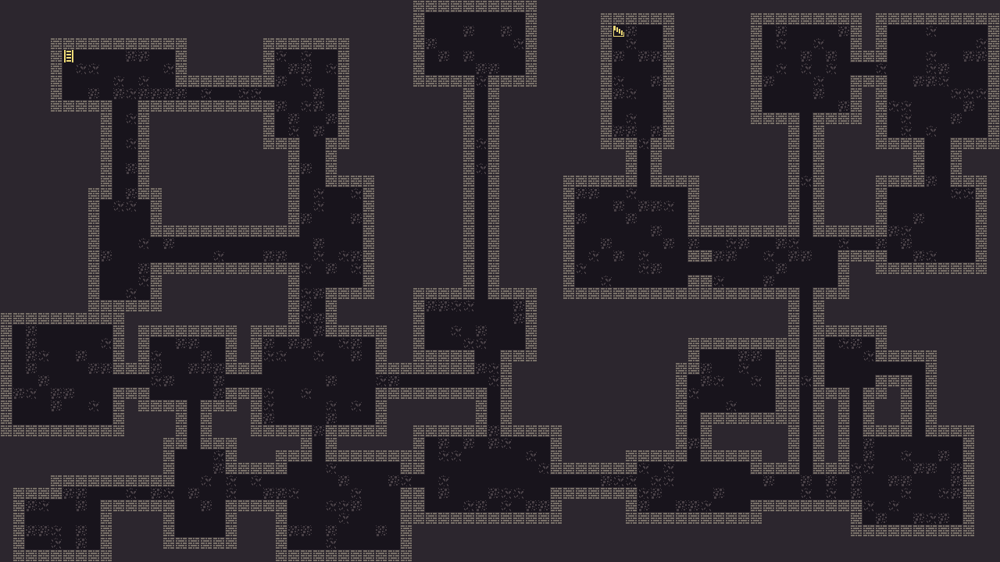
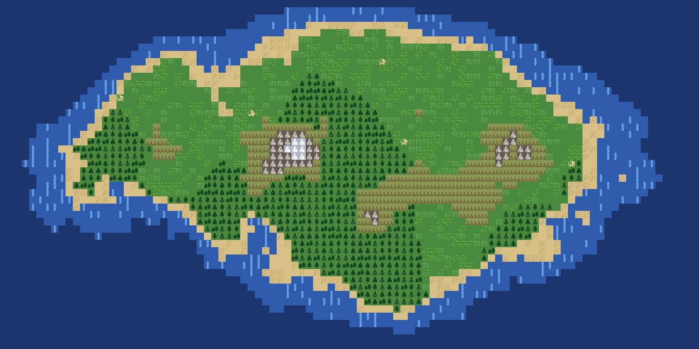
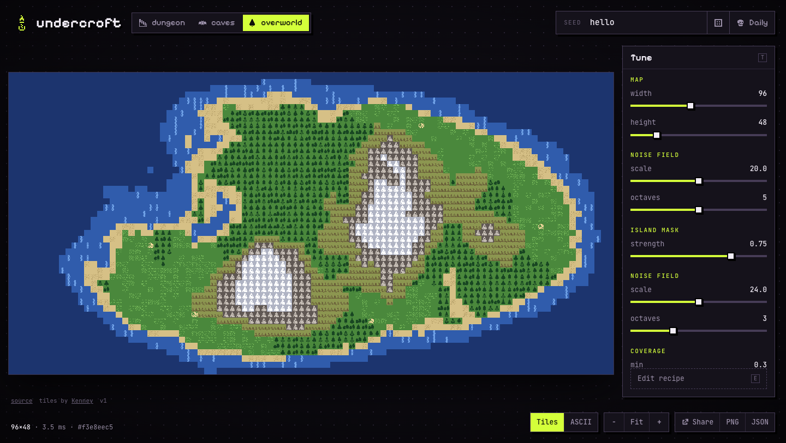

# undercroft

Seeded, validated procedural generation, built from composable stages.

Give it a seed and a recipe, and you get a world: dungeons, caves, islands or
anything you can describe as a pipeline of stages. **The same seed, recipe and
version always produce the same world, on every platform.**

**[Try the playground](https://undercroft.debugr.net/)** or
**[play today's dungeon](https://undercroft.debugr.net/play.html)**.

| `dungeon` | `overworld` |
|---|---|
|  |  |

## Quick start

```sh
cargo run -p undercroft-cli -- gen overworld --seed hello -o island.png
cargo run -p undercroft-cli -- gen dungeon --seed hello              # ASCII
cargo run -p undercroft-cli -- gen overworld --seed hello --color    # ASCII, truecolor
cargo run -p undercroft-cli -- gen caves --daily --format json
cargo run -p undercroft-cli -- styles     # built-in styles
cargo run -p undercroft-cli -- stages     # stages recipes can use
```

### Web playground



The whole generator also runs in the browser via WebAssembly: pick a style,
type a seed, drag parameter sliders or edit the recipe, and it regenerates
live. Links carry the seed (and your recipe, if you changed it), so any world
you find can be shared. Drag to pan, scroll to zoom; press `R` for a random
seed, `D` for today's daily, `1` to `3` to switch styles, `E` to edit the recipe.

```sh
rustup target add wasm32-unknown-unknown
cargo install wasm-bindgen-cli --version 0.2.117
./web/build.sh
python3 -m http.server -d web 8000   # open http://localhost:8000
```

### The daily dungeon

[`undercroft-sim`](crates/undercroft-sim) turns the generator into a small
roguelike: ten floors, turn-based bump combat, fog of war, potions and gear.
Everyone gets the same dungeon each day, and a whole run is just a seed plus
its inputs, so any run can be replayed exactly.

Balance is tuned with bots rather than guesswork:

```sh
cargo run --release -p undercroft-sim --example balance
```

CI deploys it to GitHub Pages on every push to `main`, and checks that the
wasm build produces byte-identical worlds to the native one.

## How it works

A **recipe** is a TOML list of **stages**. Each stage reads and writes a shared
**world**:

- `terrain`: a tile grid of semantic tags (`wall`, `floor`, `grass`, `water`…)
- `fields`: named scalar layers (`height`, `moisture`…)
- `areas` and `markers`: named rooms and points (`room`, `stairs_up`, `town`…)

The built-in **styles** (`dungeon`, `caves`, `overworld`) are just recipes. Copy
one from [`crates/undercroft/styles/`](crates/undercroft/styles/) and change it:

```toml
gen_version = 1
width = 80
height = 45

[tags.lava]            # define your own tags
glyph = "%"
color = [230, 80, 20]

[[stage]]
use = "fill"
tag = "wall"

[[stage]]
use = "bsp_rooms"
min_leaf = 10
min_room = 4
max_room = 12
loops = 0.2

[[stage]]
use = "place_stairs"
min_distance = 40      # rejects layouts where the stairs end up too close
```

Some stages are **checks** (`connected`, `coverage`, `place_stairs`). If a check
rejects a layout, generation retries with a deterministic next attempt, so
every world you get back satisfies its recipe.

### Determinism

- The PRNG and noise are implemented in the crate, not taken from a dependency,
  so upgrading dependencies can't change output.
- Each stage gets its own seed derived from its name, so adding or tweaking one
  stage doesn't reshuffle the others.
- Only basic float arithmetic is used, which gives the same results natively
  and in WASM.
- Snapshot tests pin the output of every style. Changes that alter output must
  bump `GEN_VERSION`.

### Tilesets

PNG output uses a tileset: a sheet of white-on-transparent tiles plus a TOML
manifest that maps tags to tiles. Tiles are tinted per tag, so one sheet covers
every style, and tags a tileset doesn't know still render as solid squares in
their own colour. See the bundled
[`kenney-1bit.toml`](crates/undercroft-render/assets/kenney-1bit.toml):

```toml
[tags.forest]
tiles = [[0, 1], [1, 1], [2, 1], [3, 1]]   # variants, picked per tile by position
fg = [24, 70, 34]                          # tint (defaults to the tag's colour)
bg = [74, 136, 60]

[tags.wall]
tiles = [[10, 17]]
hide_enclosed = true                       # solid rock shows only its outline
```

Use your own with `croft gen dungeon -o map.png --tileset my-tiles.toml`.

### Custom stages (Rust)

```rust
use undercroft::{Fail, Recipe, Registry, Rng, Seed, Stage, World, generate_with};

#[derive(serde::Deserialize)]
struct Flood { tag: String }

impl Stage for Flood {
    fn run(&self, world: &mut World, _rng: &mut Rng) -> Result<(), Fail> {
        let tag = world.tag(&self.tag)?;
        world.terrain.cells_mut().fill(tag);
        Ok(())
    }
}

let mut registry = Registry::builtin();
registry.register::<Flood>("flood");
```

## Roadmap

- [x] Core pipeline, recipes, built-in dungeon / caves / overworld styles, CLI
- [x] Tileset renderer: tinted PNG output, tile variants, custom tilesets
- [x] WebAssembly build and web playground, verified identical to native
- [x] Daily dungeon crawler with replays and share cards
- [ ] Watch replays in the browser, shared leaderboard
- [ ] Autotiling: pick wall and shoreline pieces from neighbouring tiles
- [ ] npm package
- [ ] More stages: wave-function collapse, lock-and-key progression, rivers, roads

## License

Code is MIT. The bundled tiles are Kenney's
[1-Bit Pack](https://kenney.nl/assets/1-bit-pack) (CC0). Thanks, Kenney!
